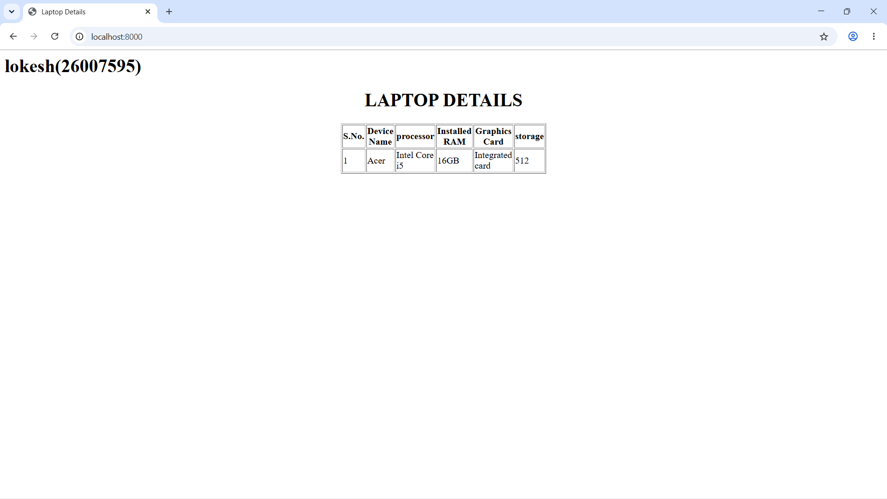
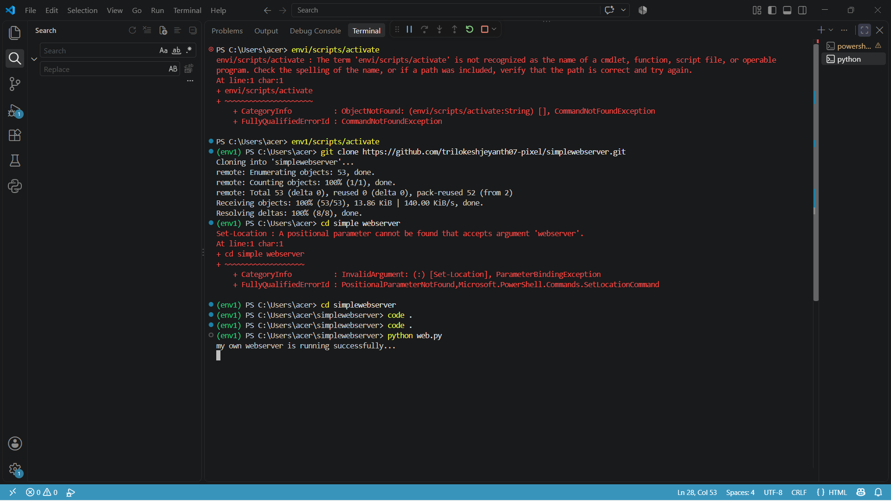

# EX01 Developing a Simple Webserver
## Date:30.09.2026

## AIM:
To develop a simple webserver to serve html pages and display the Windows Specifications of your Laptop.

## DESIGN STEPS:
### Step 1: 
HTML content creation.

### Step 2:
Design of webserver workflow.

### Step 3:
Implementation using Python code.

### Step 4:
Import the necessary modules.

### Step 5:
Define a custom request handler.

### Step 6:
Start an HTTP server on a specific port.

### Step 7:
Run the Python script to serve web pages.

### Step 8:
Serve the HTML pages.

### Step 9:
Start the server script and check for errors.

### Step 10:
Open a browser and navigate to http://127.0.0.1:8000 (or the assigned port).

## PROGRAM:
```
from http.server import HTTPServer, BaseHTTPRequestHandler
content = """
<html>
<head>
    <title>Laptop Details</title>
</head>

<body bgcolor="white">
<h1>lokesh(26007595)</h1>

    <h1 align="center">LAPTOP DETAILS</h1>


    <table border="1" align="center" cellpadding="" width="100">

        <tr>
            <th><font color="black">S.No.</font></th>
            <th><font color="black">Device Name</font></th>
            <th><font color="black">processor</font></th>
            <th><font color="black">Installed RAM</font></th>
            <th><font color="black">Graphics Card</font></th>
            <th><font color="black">storage</font></th>
        
        </tr>
        
        <tr>
            <td><font color="black">1</font></td>
            <td><font color="black">Acer</font></td>
            <td><font color="black">Intel Core i5</font></td>
            <td><font color="black">16GB</font></td>
            <td><font color="black">Integrated card</font></td>
            <td><font color="black">512</font></td>
        </tr>
    </table>

</body>
</html>

"""
class myhandler(BaseHTTPRequestHandler):
    def do_GET(self):
        print("Client request received")
        self.send_response(200)
        self.send_header('content-type', 'text/html; charset=utf-8')
        self.end_headers()
        self.wfile.write(content.encode())
server_address = ('',8000)
httpd = HTTPServer(server_address,myhandler)
print("my own webserver is running successfully...")
httpd.serve_forever()
```

## OUTPUT:
webpage

serverpage


## RESULT:
The program for implementing simple webserver is executed successfully.
